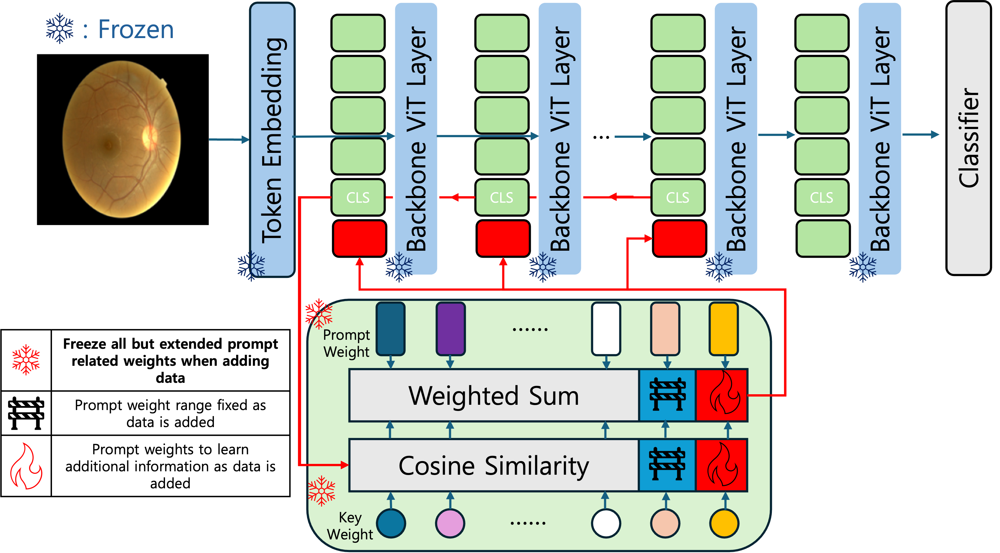
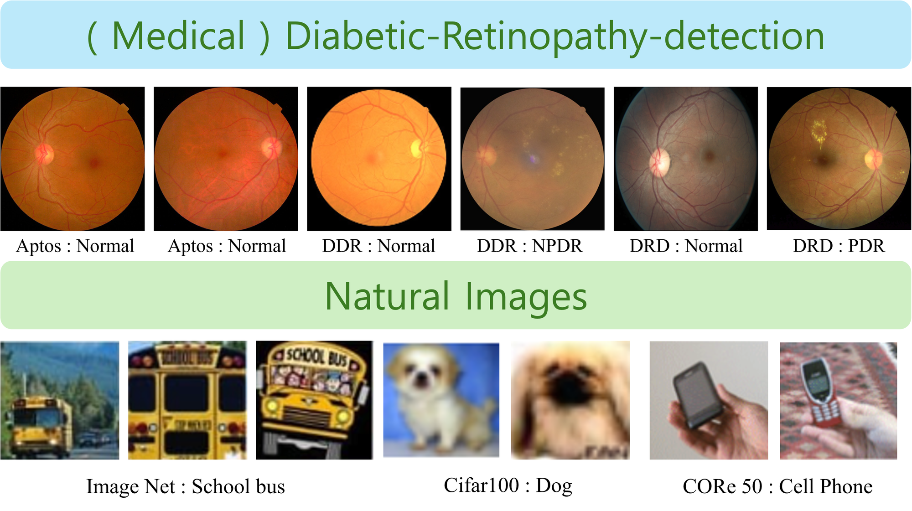
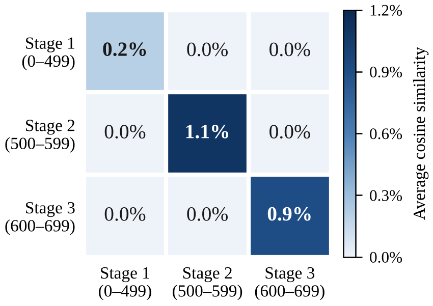

<div align="center">

# UniPrompt-CL

### Efficient Single-Inference Continual Learning for Medical Image Classification

**Gyutae Oh** &nbsp;·&nbsp; **Jitae Shin**<br>
Department of Electrical and Computer Engineering, Sungkyunkwan University

[](https://wacv.thecvf.com/Conferences/2027)
[](https://www.python.org/)
[](https://pytorch.org/)
[](LICENSE)



</div>

UniPrompt-CL is a **rehearsal-free, domain-incremental** continual learning framework for medical image classification that runs with a **single backbone and a single inference pass**. Instead of keeping an independent prompt pool at every transformer layer, it shares **one unified prompt pool across layers** and grows it by only a few prompts whenever a new domain (hospital, device, acquisition protocol) arrives.

## Highlights

- **Single backbone, single inference.** No auxiliary query network and no second forward pass; the layer-wise `[CLS]` token is the query.
- **Unified prompt pool.** One pool shared across prompted layers removes the cross-layer redundancy of layer-wise pools.
- **Lightweight stage-wise expansion.** Each new domain adds a small block of prompts (20% of the pool); earlier prompts are frozen, so past knowledge is preserved without replaying patient data.
- **Surrogate selection loss.** A regularizer that keeps newly added prompts from being ignored early in a new stage.
- **Lowest training cost among DINOv2-B configurations**: 44.17 GFLOPs per step vs. 66.42 for OS-Prompt and 137.93 for DualPrompt, with the highest AvgACC and lowest forgetting on diabetic retinopathy.

<div align="center">

<br><sub>Domain shifts in medical streams (top) are subtle and fine-grained compared with the large appearance changes in natural-image benchmarks (bottom).</sub>
</div>

## Results

Backbone-controlled comparison (all methods with DINOv2-B). Mean ± std over three seeds; GFLOPs is the per-step training cost (forward and backward) and does not depend on the benchmark.

| Method | GFLOPs ↓ | DR AvgACC ↑ | DR AvgF ↓ | Skin AvgACC ↑ | Skin AvgF ↓ |
|:--|--:|--:|--:|--:|--:|
| OS-Prompt | 66.42 | 0.801 ± 0.005 | 0.165 ± 0.006 | 0.726 ± 0.011 | 0.094 ± 0.021 |
| OS-Prompt++ | 86.68 | 0.812 ± 0.023 | 0.125 ± 0.052 | 0.724 ± 0.011 | 0.103 ± 0.020 |
| CPS-Prompt | 92.69 | 0.692 ± 0.001 | 0.116 ± 0.017 | 0.720 ± 0.015 | 0.087 ± 0.035 |
| Coda-Prompt | 175.12 | 0.824 ± 0.003 | 0.154 ± 0.024 | 0.716 ± 0.024 | 0.109 ± 0.036 |
| DualPrompt | 137.93 | 0.733 ± 0.009 | 0.104 ± 0.018 | 0.728 ± 0.002 | 0.079 ± 0.007 |
| **UniPrompt-CL (ours)** | **44.17** | **0.844 ± 0.016** | **0.079 ± 0.032** | **0.732 ± 0.022** | **0.049 ± 0.043** |

DR: APTOS → DDR → DRD. Skin: ISIC → HAM10000 → Derm7pt. The full comparison, including baselines in their original ViT-B/16 configuration, is in Table 1 of the paper.

<div align="center">

<br><sub>Prompts added at different stages stay nearly orthogonal: each expansion contributes new directions rather than duplicating existing ones.</sub>
</div>

## Installation

```bash
git clone https://github.com/GYUGYUT/UniPrompt-CL.git
cd UniPrompt-CL

conda create -n uniprompt python=3.8 -y
conda activate uniprompt

# PyTorch 2.4.1 with CUDA 11.8 (adjust the index URL to your CUDA version)
pip install torch==2.4.1 torchvision==0.19.1 --index-url https://download.pytorch.org/whl/cu118
pip install -r requirements.txt
```

`requirements.txt` lists the packages the code imports. `requirements-freeze.txt` is the exact environment the paper's experiments were run in, for reference. The DINOv2-B weights (`facebook/dinov2-base`) are downloaded automatically from the Hugging Face Hub on first use.

## Data preparation

### Datasets

| Stream | Stage 1 | Stage 2 | Stage 3 | Classes |
|:--|:--|:--|:--|:--|
| Diabetic retinopathy (`dr`) | [APTOS 2019](https://www.kaggle.com/competitions/aptos2019-blindness-detection) | [DDR](https://github.com/nkicsl/DDR-dataset) | [DRD (Kaggle)](https://www.kaggle.com/competitions/diabetic-retinopathy-detection) | 3 (normal / NPDR / PDR) |
| Skin cancer (`skin`) | [ISIC 2020](https://challenge2020.isic-archive.com/) | [HAM10000](https://dataverse.harvard.edu/dataset.xhtml?persistentId=doi:10.7910/DVN/DBW86T) | [Derm7pt](https://derm.cs.sfu.ca/) | 2 |

Download each dataset from its official source and place the images as follows (the root is configurable with `--medical_data_root`):

```text
data/
├── aptos_train/   aptos_val/   aptos_test/
├── ddr/
├── drd/
└── skin/
    ├── ISIC/
    ├── HAM10000/
    └── Derm7pt/
```

### Stage splits

The exact train/validation/test splits used in the paper are provided as CSV files (`filepath,label`, paths relative to the data root):

```text
dataloader/stage_splits/dr/    stage{1,2,3}_{aptos,ddr,diabetic}_{train,val,test}.csv
dataloader/stage_splits/skin/  stage{1,2,3}_{ISIC,HAM10000,Derm7pt}_{train,val,test}.csv
```

No further preprocessing is needed. If you want to regenerate the stage CSVs from the original dataset metadata, see `tools/prepare_medical_stages.py`.

### Optional: tensor cache

For faster epochs you can cache the decoded 224 × 224 images as uint8 tensor shards once and train from the cache:

```bash
python main.py --dataset dr --num_classes 3 --diabetic_classes 3 --img_size 224 \
  --cache_mode uint8 --build_cache
```

Subsequent runs with `--cache_mode uint8` reuse the shards under `dataloader/tensor_cache/<dataset>/` (or `--cache_dir`).

## Training

Each run trains the three stages sequentially with the rehearsal-free protocol (no access to past-stage data) and evaluates on every stage seen so far after each one. The settings below are those of the paper (Sup. Table 6): AdamW, lr 1e-3, cosine schedule, 100 epochs with early-stopping patience 5, batch size 64, a 500-prompt pool expanded by 100 prompts per stage, and λ = 0.001.

```bash
# Diabetic retinopathy: APTOS -> DDR -> DRD
bash scripts/train_dr.sh

# Skin cancer: ISIC -> HAM10000 -> Derm7pt
bash scripts/train_skin.sh
```

Both scripts are thin wrappers around `main.py`; the main options are:

| Option | Meaning | Paper value |
|:--|:--|:--|
| `--dataset {dr,skin}` | which stream to train | – |
| `--num_prompts` | size of the initial prompt pool $L_p$ | 500 |
| `--expand_per_stage` | prompts added at each later stage $\psi$ | 100 |
| `--prompt_dim` | prompt dimension $D$ | 768 |
| `--lambda_qr` | weight of the surrogate selection loss $\lambda$ | 1e-3 |
| `--lr`, `--scheduler`, `--epochs`, `--patience` | optimization | 1e-3, cosine, 100, 5 |
| `--batch_size`, `--img_size` | input | 64, 224 |
| `--gpu_ids` | comma-separated GPU ids (DataParallel) | – |

See [`docs/RUN_EXPERIMENTS.md`](docs/RUN_EXPERIMENTS.md) for the full list, including cache and custom-path options.

## Outputs

Each run writes to a timestamped folder under `results/`:

```text
results/<timestamp>/
├── cl_accuracy_matrix.csv     # R[i, j]: accuracy on stage j after training stage i
├── cl_macro_f1_matrix.csv
├── cl_metrics.json
├── cl_metrics_summary.txt     # AvgACC, BWT, AvgF (accuracy and macro-F1)
├── step1/  step2/  step3/     # per-stage checkpoints (best_model.pth) and test artifacts
```

Metric definitions (AvgACC, BWT, AvgF, FAA, FAF) follow the supplementary material, Sec. F.

## Repository layout

```text
main.py                     entry point: runs the three stages in sequence
network/model.py            DINOv2 backbone with the unified prompt pool (PromptPool) and prefix injection
network/loss.py             surrogate selection loss
train/ddp_train.py          stage-wise training / evaluation loop and continual-learning metrics
dataloader/                 stage CSV loaders, uint8 tensor cache, legacy per-dataset loaders
dataloader/stage_splits/    the exact splits used in the paper
tools/prepare_medical_stages.py   rebuild stage CSVs from the original dataset metadata
scripts/                    launchers with the paper's hyperparameters
docs/RUN_EXPERIMENTS.md     detailed command-line reference
```

## Citation

If you find this work useful, please cite:

```bibtex
@inproceedings{oh2027uniprompt,
  title     = {{UniPrompt-CL}: Efficient Single-Inference Continual Learning for Medical Image Classification},
  author    = {Oh, Gyutae and Shin, Jitae},
  booktitle = {Proceedings of the IEEE/CVF Winter Conference on Applications of Computer Vision (WACV)},
  year      = {2027}
}
```

## Acknowledgments

This work was supported by the BK21 FOUR Project and by a National Research Foundation of Korea (NRF) grant funded by the Korean government (MSIT) (RS-2026-25589675). The implementation builds on the single-backbone design of OS-Prompt (Kim et al., ECCV 2024) and uses the [DINOv2](https://github.com/facebookresearch/dinov2) backbone through [Hugging Face Transformers](https://github.com/huggingface/transformers).

## License

This repository is released under the [MIT License](LICENSE).
